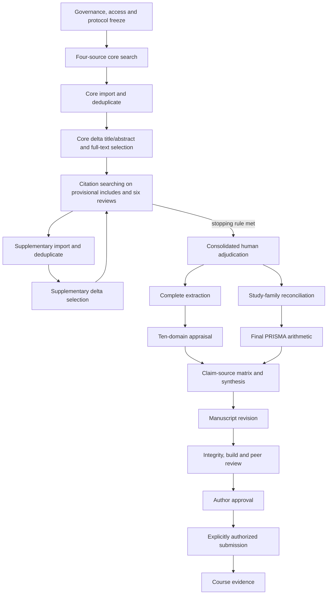

# Specification: Complete the HK261 PRISMA Systematic Review

**Document ID:** `HK261-PRISMA-COMPLETION-SPEC-v2`

**Status:** `APPROVED`

**Created:** 2026-11-26

**Updated:** 2026-11-26

**Approved:** 2026-11-26T12:56:23+07:00 by explicit user confirmation

**Applies to:** `Slide PPNCKH/Bai_tap_ve_nha/systematic_review_prisma/`

**Current scientific baseline:** 46 reports; 36 working includes, 2 excludes, 8 uncertain; 24 detailed extractions, 12 minimum extractions; 24 partial appraisals; final study count unknown.
**Current manuscript baseline:** 22-page Springer Nature review copy, 53 cited references, explicitly interim and not submitted.

**v2 decision record:** The user confirmed SN Computer Science with the Springer Nature LaTeX template as the sole active venue/template and confirmed access to IEEE Xplore, ACM Digital Library, Scopus and Web of Science. Access confirmation establishes readiness only; a database counts as searched only after its official export and reproducibility log pass the search gate.

**v2 review disposition:** Four external-review findings were accepted directly, two were accepted with a methodological/workflow constraint, and one additional usability improvement was accepted. Citation searching now forms an auditable delta-screening loop; the existing 46 reports are not mechanically re-screened; database access has an explicit gate; bibliography audit covers 100% of `references.bib`; build instructions come from the approved venue profile; logical execution batches reduce Git overhead without weakening criterion-level gates; and human adjudication uses one consolidated packet. The short-paper finding was corrected: page count alone is not an eligibility rule.

## 1. Objective

Complete a truthful, reproducible systematic review of collaborative neural-network inference in UAV swarms, reported with PRISMA 2020, and produce a consistent LaTeX/PDF manuscript whose claims are supported by accepted full-text evidence.

The specification separates three completion levels so that one cannot be mistaken for another:

1. **Review complete:** searches, record management, selection, extraction, appraisal, synthesis and PRISMA reporting are complete.
2. **Manuscript submission-ready:** review complete, manuscript scientifically and visually verified, venue/template and authorship metadata approved.
3. **HK261 coursework complete:** manuscript actually submitted after explicit authorization, the journal receipt is archived, and course evidence is forwarded as required.

The immediate implementation goal after approval of this specification is **Level 1**. Level 2 requires author decisions. Level 3 requires explicit user authorization and live external actions.

## 2. Authority and precedence

Apply requirements in this order:

1. Current system/developer instructions and the latest user instruction.
2. Official HK261 assignment PDF.
3. Recorded user decisions in `MUST_READ_AI_AGENT/01_PROJECT_CHARTER.md` and canonical `current_state.json`.
4. `protocol.md` and dated protocol amendments.
5. Accepted evidence, project gates and this approved specification.
6. Historical plans, provider output and reviewer comments.

Reviewer comments are inputs, not authority. A requested change enters implementation only after it is verified against the manuscript and sources.

### 2.1 v2 review disposition

| Finding | Verdict | Implemented change |
|---|---|---|
| S-06 ran before eligibility selection | `ACCEPT` | S-06 now begins from provisional included reports plus six background reviews, and every discovered record loops through D-04/E-01–E-03 until the stopping rule passes. |
| S03/S19 prove a page-length inconsistency | `ACCEPT_WITH_CORRECTION` | G-04/E-04 use publication type and substantive content; page count alone cannot include or exclude a report. |
| Existing 46 reports could be screened again | `ACCEPT` | D-03 supplies inherited decisions; E-01–E-03 operate on uncovered delta records unless an amendment affects an old decision. |
| Four databases need an access gate | `ACCEPT` | DEC-08 records 4/4 user-confirmed access; G-04/S-01 verify the official routes before final searches. |
| Per-component Git overhead is excessive | `ACCEPT_WITH_CONSTRAINT` | Fifteen logical execution batches are Git tasks; every component criterion retains separate PASS/FAIL evidence. |
| X-05/build instructions are too narrow | `ACCEPT` | X-05 covers 100% of `references.bib`; Q-02 follows the G-03-approved build profile. |
| Human decisions would be fragmented | `ACCEPT` | E-05 produces one consolidated CSV/Markdown adjudication packet. |

## 3. Confirmed requirements

- Review type: systematic review reported using PRISMA 2020.
- Topic: collaborative DNN/neural-network inference in multi-UAV or UAV-swarm systems, focusing on partitioning, orchestration and resilience.
- Publication window: 2021-01-01 through the documented final search date.
- Evidence must come from real sources. Fabricated citations, DOI values, counts, results, dates, author approvals and submission evidence are forbidden.
- Detailed extraction and quantitative synthesis require readable full text.
- Records, reports and studies are distinct accounting units.
- Reviews may support positioning and citation chaining but are not primary included studies.
- Canonical manuscript is LaTeX compiled to PDF.
- The sole active venue/template is SN Computer Science using the official Springer Nature LaTeX template; the earlier IEEE-template request is superseded for this project version.
- The user has confirmed access readiness for all four core databases: IEEE Xplore, ACM Digital Library, Scopus and Web of Science. Search completion still requires actual official-interface execution and archived exports.
- Codex owns writing, project edits, acceptance, Git and final user-facing text.
- Gemini or the approved low-cost fallback may return read-only research evidence; neither writes final prose nor accepts its own output.
- Every task uses one branch/worktree, one task-owned diff, explicit validation, an atomic commit, fast-forward integration and cleanup.
- Every task updates current state and appends matching timestamped event/decision evidence.
- Submission and course email are prohibited until the user explicitly authorizes those external actions.

## 4. Assumptions and decisions

### 4.1 Assumptions used by this specification

1. The existing 46-report corpus remains evidence, but is not assumed to be the complete corpus.
2. The 36 working inclusions remain provisional until human adjudication and study-family reconciliation finish.
3. The 53 current references remain candidates for the final bibliography; their presence does not replace source, retraction and metadata verification.
4. Narrative synthesis is the default. Meta-analysis is permitted only if a homogeneous subset has compatible outcomes and variance information.
5. A single human author may perform final adjudication under the fixed protocol. Independent dual-human screening and Cohen's kappa are optional robustness enhancements, not universal PRISMA requirements.
6. A unified mathematical formulation is optional and target-dependent. It must not be introduced merely to imitate a survey journal.
7. Report completeness is determined by publication type and substantive content, not a minimum page count. A short paper remains eligible only when it provides enough primary-research methods, system/model description, evaluation and results for the frozen extraction and appraisal rules. Demo abstracts, poster abstracts and work-in-progress notices without that content are excluded.

### 4.2 Decision register

| Decision ID | Decision | Status/value | Blocks |
|---|---|---|---|
| DEC-01 | Final venue and template | **RESOLVED:** SN Computer Science/Springer Nature LaTeX | Nothing in Level 1 |
| DEC-02 | Whether IEEE supersedes SN Computer Science | **RESOLVED:** no; IEEE copy is not active | Nothing in Level 1 |
| DEC-03 | Author order, corresponding author and supervisor | Unknown | Submission-ready status |
| DEC-04 | Verified HCMUT email, affiliations, ORCID and doctoral student ID | Unknown | Author block and submission |
| DEC-05 | Contributions, funding, conflicts, data availability and final AI declaration | Unknown | Declarations and submission |
| DEC-06 | Examination date | Unknown; never guess | Course deadline calculation |
| DEC-07 | Authorization to submit and later send course email | Not granted | External actions |
| DEC-08 | Access to four core databases | **RESOLVED:** user confirms 4/4; official search/export evidence pending | Search execution, not protocol design |

Scientific work that does not depend on unresolved DEC-03 through DEC-07 should continue after this specification is approved.

## 5. Definitions

- **Record:** one database/export entry before deduplication.
- **Report:** one retrievable paper, preprint or document.
- **Study:** one underlying investigation; several reports may belong to one study.
- **Accepted evidence:** evidence that passed every mandatory criterion in a Codex review table.
- **Uncertain:** evidence is insufficient for a final decision. It is not a synonym for include or exclude.
- **Not reported:** the full report was checked and the item was not found.
- **Not extracted:** the extraction has not yet established whether the item is reported.
- **Review complete:** all Level-1 definition-of-done criteria in Section 8 pass.

## 6. Required project structure

| Purpose | Canonical location |
|---|---|
| Protocol and amendments | `protocol.md`, `protocol_amendment_*.md` |
| Exact platform queries | `final_query_translations.md` |
| Immutable raw exports | `sources/raw/` |
| Normalized records | `sources/normalized/` |
| Formal search ledger | `formal_search_log_v0.2.csv` or a versioned successor |
| Record screening | `screening_log.csv` or a versioned successor |
| Report/study linkage | `study_report_map.csv` |
| Full-text evidence | `screening_46/` plus versioned delta intake |
| Final extraction/appraisal | New dated/versioned release directory; do not overwrite accepted releases |
| Claim-source matrix | New final release directory |
| PRISMA checklist | `prisma_2020_checklist_working.md`, promoted only after final audit |
| Manuscript source | `manuscript/sn_computer_science/main.tex` |
| Bibliography | `manuscript/sn_computer_science/references.bib` |
| Compiled PDF | Canonical `main.pdf`; user-friendly copies belong under `output/` |
| Approved build profile | `manuscript/sn_computer_science/build_profile.json`, created/verified under G-03 before Q-02 |
| Current state/history | `MUST_READ_AI_AGENT/current_state.json`, `events.jsonl`, Git |
| Automation evidence | `automation/decision_log.jsonl`, `artifact_catalog.json` |
| Submission proof | `submission_evidence/` |

## 7. Global execution contract

Every task below must use this record before work begins:

```text
TASK: <one concrete task>
OWNER: CODEX_WRITING | GEMINI_RESEARCH | USER_ACTION
OWNED_PATHS: <explicit paths>
BINARY_ACCEPTANCE: <numeric/binary checks>
PRE_TASK_GIT_STATUS: <branch, staged/modified/untracked counts, preceding commit>
CODE_FIRST_DECISION: REUSE_EXISTING | WRITE_SCRIPT | MANUAL -- <reason>
```

For a Gemini task, Codex must commit the structured brief before dispatch. The brief must contain `TASK`, `REQUIRED WORK`, `REQUIRED OUTPUT`, `ACCEPTANCE CRITERIA` and `BOUNDARIES`. Codex then produces a criterion-by-criterion PASS/FAIL review. A result with any mandatory FAIL remains quarantined.

One execution batch is one Git task: it uses one branch/worktree, one task-owned diff, one closing state/event/decision update and one atomic commit. Every component criterion inside the batch still receives its own PASS/FAIL evidence. Do not group unrelated phases, skip a component gate or start the next batch before integration and cleanup.

### 7.1 Approved execution batches

| Batch | Component tasks | Git-task boundary |
|---|---|---|
| B01 | G-01, G-03 | Approve v2 and record the already supplied venue/template decision |
| B02 | G-02 | Restore the canonical workspace/PDF baseline without altering unrelated user files |
| B03 | G-04, S-01 | Freeze protocol, verify 4/4 access routes and validate queries |
| B04 | S-02–S-05 | Execute and archive the four core searches |
| B05 | D-01–D-03 | Import core exports, deduplicate and map the existing 46 reports |
| B06 | E-01–E-03 | Screen only the core delta not already represented by the controlled 46-report set |
| B07 | S-06, D-04, E-01–E-03 repeat | Run citation searching and delta intake/screening until the stopping rule passes |
| B08 | E-04–E-06 | Resolve edge cases, obtain one consolidated human adjudication and reconcile study families |
| B09 | X-01–X-05 | Complete extraction, appraisal and the full-bibliography source audit |
| B10 | Y-01–Y-06 | Build claim matrix, taxonomy, figures and evidence-bounded synthesis |
| B11 | M-01–M-06 | Iterate Methods–Results–Discussion–Introduction and finalize front matter |
| B12 | M-07–M-09 | Normalize references, add verified metadata and apply the approved Springer template |
| B13 | P-01–P-04 | Reconcile PRISMA, generate flow/checklist and package reproducibility artifacts |
| B14 | Q-01–Q-05 | Run integrity/build/visual/independent review and obtain final author approval |
| B15 | U-01–U-05 | External submission and course evidence; blocked until explicit authorization |

## 8. Definitions of done

### 8.1 Level 1 — systematic review complete

All of the following must pass:

- [ ] Access readiness for IEEE Xplore, ACM Digital Library, Scopus and Web of Science is recorded as 4/4 before final searches; all four sources then have completed official-interface searches, or a prospective protocol amendment documents any source-set change before that source is replaced or omitted.
- [ ] Every executed search has platform, exact query, filters, actual date, reported total, exported total, immutable raw file and checksum.
- [ ] All raw records are imported; import count equals the sum of exports after documented platform/export limitations.
- [ ] Duplicate normalized DOI count is zero.
- [ ] Duplicate normalized title/year/first-author records are resolved or explicitly linked.
- [ ] Every record has a title/abstract decision.
- [ ] Every potentially eligible report has a retrieval status.
- [ ] Every retrieved full-text report has a final include/exclude decision and one primary reason when excluded.
- [ ] Citation searching has completed at least one full backward/forward pass over the provisional included reports and six background reviews; all unique supplementary records have passed the same delta deduplication and eligibility process, and the documented stopping rule has been met.
- [ ] The current eight uncertain reports are reduced to zero unresolved final eligibility decisions.
- [ ] Nguyễn Minh Hiếu has adjudicated every final full-text eligibility decision.
- [ ] Every included report is linked to a final study family or explicitly justified as a standalone study.
- [ ] Final record, report and study counts reconcile with zero unexplained difference.
- [ ] Every included study/report has a complete extraction row; each required field contains a source locator, `not reported`, or a justified `not applicable` value.
- [ ] Every included study has ten appraisal-domain judgments with rationale; no `WITHHELD` or `NOT_ASSESSED` remains.
- [ ] Every quantitative manuscript claim has source, locator, conditions, unit and evidence boundary.
- [ ] All review questions have a claim-source matrix and evidence-bounded synthesis.
- [ ] Reporting-bias, certainty and sensitivity methods are performed where justified, or their non-performance is explicitly justified without implying low bias/high certainty.
- [ ] Final PRISMA flow uses reconciled counts.
- [ ] All 27 PRISMA checklist items contain accurate locators and statuses; `PARTIAL`, `NOT PERFORMED`, `NOT ASSESSED` and `UNCONFIRMED` remain only when genuinely inapplicable or disclosed as a final limitation.

### 8.2 Level 2 — manuscript submission-ready

Level 1 passes, plus:

- [ ] Venue and official template are confirmed once; zero competing active manuscript sources.
- [ ] Author order, consent, corresponding author, supervisor, HCMUT/VNU-HCM affiliations, HCMUT email and ORCIDs are verified.
- [ ] Contributions, funding, conflicts, data availability, acknowledgements and AI declaration are approved.
- [ ] Title, Abstract, Keywords, Methods, Results, Discussion, Introduction and Conclusion agree with the final evidence.
- [ ] All cited sources are opened and verified; unresolved DOI/identity/retraction/correction cases equal zero or are removed.
- [ ] Bibliography contains only cited sources; undefined and uncited bibliography keys equal zero.
- [ ] LaTeX build has zero fatal errors, undefined citations/references and overfull boxes.
- [ ] Every PDF page is visually inspected at readable resolution; clipped/overlapping/unreadable elements equal zero.
- [ ] Independent manuscript review has no unresolved critical finding.
- [ ] All authors approve the exact final PDF and source package.

### 8.3 Level 3 — HK261 coursework complete

Level 2 passes, plus:

- [ ] User explicitly authorizes submission to one verified venue.
- [ ] Portal metadata equals the approved manuscript metadata.
- [ ] System-generated submitted copy, manuscript ID, timestamp and receipt are archived.
- [ ] Exact exam date is known and the three-day deadline is calculated without guessing.
- [ ] User explicitly authorizes the course email.
- [ ] Evidence is forwarded to `duyanhnguyen@hcmut.edu.vn` with the prescribed subject, name, verified doctoral student ID, manuscript ID and receipt.
- [ ] Sent-message evidence is archived without committing credentials or private mailbox contents.

## 9. Dependency graph



Search, screening, extraction and manuscript writing may use parallel read-only research tasks only when their inputs are frozen and their owned records do not overlap. Acceptance and project writes remain sequential under Codex.

## 10. Task specification

### Phase G — governance, scope and canonical baseline

#### G-01 — Approve this specification

- **Owner:** `USER_ACTION`; Codex records the decision.
- **Dependencies:** none.
- **Required work:** Review scope, completion levels, task dependencies, open decisions and non-goals. Record requested amendments before research resumes.
- **Output:** Approved spec version or a dated superseding version.
- **Acceptance:** One explicit user approval; unresolved spec objections listed; zero implementation task started before approval.
- **Verify:** Git history contains the approved version; `current_state.json.next_task` points to G-02 or another approved first task.

#### G-02 — Restore a canonical, non-ambiguous working baseline

- **Owner:** `CODEX_WRITING`; any user-created rename requires confirmation.
- **Dependencies:** G-01.
- **Required work:** Resolve the current deleted `main.pdf` plus same-hash renamed copy; remove or ignore `.DS_Store` residue without deleting user research; ensure one canonical manuscript PDF and optional copy under `output/`.
- **Output:** Canonical path matches `06_FILE_MAP.md`; task-owned Git status clean.
- **Acceptance:** `main.pdf` exists at the canonical path; SHA-256 equals the accepted PDF or a newly built verified PDF; ambiguous duplicate active PDFs = 0; task-owned dirty paths = 0.
- **Verify:** `git status --short`, SHA-256 comparison, project-state validation.

#### G-03 — Confirm review scope and venue/template policy

- **Owner:** `CODEX_WRITING` records the user-supplied DEC-01/DEC-02 choice.
- **Dependencies:** G-01.
- **Required work:** Record SN Computer Science as the sole active venue, preserve the official Springer Nature LaTeX template, mark the earlier IEEE request superseded and create a machine-readable build profile containing the canonical working directory, entry source, build command and expected PDF.
- **Output:** One dated venue decision, one canonical manuscript path and `manuscript/sn_computer_science/build_profile.json`.
- **Acceptance:** Active venue count = 1; active manuscript source count = 1; profile fields `venue`, `working_directory`, `entry_source`, `command` and `expected_pdf` are non-empty; historical versions clearly labelled; no silent template conversion.
- **Verify:** Project charter, file map, current state and build-profile path agree; profile command is executed in Q-02.

#### G-04 — Freeze final protocol and verify access readiness

- **Owner:** `CODEX_WRITING`.
- **Dependencies:** G-01; G-03 only if venue imposes relevant review requirements.
- **Required work:** Recheck RQs, eligibility, date boundary, source set, query concepts, selection, extraction, appraisal and synthesis. Record the user's 4/4 access confirmation and verify an official-interface login/export route for each core database before its final search. Define report completeness by publication type and substantive methods/system/evaluation/results content; do not impose an arbitrary page threshold. Create a dated amendment only for an actual protocol change and state its impact on completed work.
- **Output:** Frozen protocol plus amendments/version identifier, four-source access-readiness matrix and explicit short/full/demo/WIP decision rule.
- **Acceptance:** Every method element has one canonical definition; access routes verified = 4/4 or a blocked route is recorded before search execution; arbitrary minimum-page rules = 0; short primary reports are eligible only when extraction/appraisal content is sufficient; demo/poster/WIP abstracts without sufficient methods/results are excluded; undisclosed retrospective changes = 0; RQs and extraction fields map one-to-one.
- **Verify:** Protocol diff audit, amendment table, four-source access evidence and explicit recheck instructions for S03/S19 plus all delta reports.

### Phase S — reproducible identification search

#### S-01 — Validate platform queries and seed coverage

- **Owner:** `GEMINI_RESEARCH` for verification notes; `CODEX_WRITING` accepts and writes.
- **Dependencies:** G-04.
- **Required work:** Verify the eight translated queries against the frozen concepts and known seeds. Identify syntax unsupported by each platform and confirm that the G-04 official-interface/export route remains usable. Do not claim a database search from access testing alone.
- **Output:** Query validation matrix for IEEE, ACM, Scopus and Web of Science.
- **Acceptance:** 8/8 queries present; all mandatory concepts represented; 20 seed × 8 query cells evaluated or documented shortfall; usable access/export routes = 4/4 before S-02–S-05; unsupported syntax count and corrections explicit; fabricated result counts = 0.
- **Verify:** Deterministic matrix checker or CSV assertions; Codex PASS/FAIL table.

#### S-02 — Execute and archive IEEE Xplore search

- **Owner:** `USER_ACTION` if institutional login/takeover is required; otherwise `CODEX_WRITING`; Gemini may verify metadata afterward.
- **Dependencies:** S-01.
- **Required work:** Run the approved IEEE query through the official interface, apply the date/document filters, export all permitted results and record caps/errors.
- **Output:** Immutable raw export and one search-log row.
- **Acceptance:** Exact query, filters, actual timestamp, reported total, exported total, file name, checksum and limitation all non-empty; reported/export arithmetic explained; no inferred count after access failure.
- **Verify:** Raw file parses; row count equals exported total or documented platform export behavior.

#### S-03 — Execute and archive ACM Digital Library search

- **Owner/dependencies/work/output:** Same contract as S-02, using ACM's official interface.
- **Dependencies:** S-01.
- **Acceptance:** Same eight required log fields; raw export parse succeeds; no Cloudflare/access page counted as a result export.
- **Verify:** Parsed count and checksum.

#### S-04 — Execute and archive Scopus search

- **Owner/dependencies/work/output:** Same contract as S-02, using institutional Scopus access.
- **Dependencies:** S-01.
- **Acceptance:** Same eight required log fields; complete export or explicit documented platform cap and continuation exports.
- **Verify:** Sum of continuation exports equals logged exported total; duplicate export rows identified for later deduplication, not silently removed from raw files.

#### S-05 — Execute and archive Web of Science Core Collection search

- **Owner/dependencies/work/output:** Same contract as S-02, using institutional Web of Science access.
- **Dependencies:** S-01.
- **Acceptance:** Same eight required log fields; complete export or explicit documented platform cap and continuation exports.
- **Verify:** Parsed count, checksum and continuation arithmetic.

#### S-06 — Supplementary citation searching

- **Owner:** `GEMINI_RESEARCH`; Codex accepts.
- **Dependencies:** E-03 has produced provisional included reports from at least one core/delta pass; the six background reviews are identified and source-verified.
- **Required work:** Perform backward and forward citation searching for every provisional included primary report and all six background reviews using official/publisher/citation-index locators. Pass every unique supplementary record to D-04 and the E-01–E-03 delta process. Repeat after newly included supplementary reports until one complete citation-search iteration yields zero new unique records requiring eligibility screening, or a prospectively documented stopping rule is satisfied.
- **Output:** Versioned supplementary-discovery ledger with parent source, discovery direction, locator, date, iteration and downstream delta-record ID.
- **Acceptance:** Provisional included parent coverage = 100%; background-review parent coverage = 6/6; every supplementary record has parent locator and discovery date; duplicate DOI/title after comparison with the master ledger is labelled, not silently dropped; every unique record has a D-04/E-stage status; final iteration adds zero new unique records requiring screening or the approved stopping rule is documented; unsupported claims = 0.
- **Verify:** Codex criterion table, normalized identity checker and iteration arithmetic.

### Phase D — import, normalization and deduplication

#### D-01 — Import all raw exports into a normalized record ledger

- **Owner:** `CODEX_WRITING`; code-first preference `REUSE_EXISTING`, then a small tested parser if formats require it.
- **Dependencies:** S-02 through S-05.
- **Required work:** Preserve raw files unchanged; parse every export; normalize field names, DOI and titles; retain source and raw-row provenance.
- **Output:** Versioned normalized record ledger and import audit.
- **Acceptance:** Every parsed raw row maps to exactly one normalized input row before deduplication; missing mandatory identity fields explicitly marked; import exceptions = 0 or documented per row; raw-file hash changes = 0.
- **Verify:** Automated count reconciliation and schema validation.

#### D-02 — Deduplicate records and link publication versions

- **Owner:** `GEMINI_RESEARCH` may investigate ambiguous identities; `CODEX_WRITING` accepts and writes.
- **Dependencies:** D-01.
- **Required work:** Deduplicate first by normalized DOI, then normalized title/year/first author; link preprint, conference and journal reports instead of deleting relationships.
- **Output:** Deduplicated record ledger, duplicate map and version-link candidates.
- **Acceptance:** Duplicate normalized DOI count in retained records = 0; duplicate normalized title identity count = 0 or explicitly linked; every removed record has retained-record ID and reason; arithmetic `raw normalized = retained + duplicates` has difference 0.
- **Verify:** Reproducible deduplication script/tests and Codex semantic review of ambiguous pairs.

#### D-03 — Map the existing 46 reports into the final record ledger

- **Owner:** `CODEX_WRITING`.
- **Dependencies:** D-02.
- **Required work:** Link each existing report to one or more discovery records, or document why the report originates only from supplementary/user-supplied discovery.
- **Output:** 46-row provenance overlay.
- **Acceptance:** Existing report IDs accounted = 46/46; mapped-to-core, supplementary and user-supplied counts sum to 46; unmapped reports have explicit provenance limitation; four prior arXiv records reconciled.
- **Verify:** ID set equality and count arithmetic.

#### D-04 — Import and deduplicate supplementary citation-search records

- **Owner:** `CODEX_WRITING`; Gemini may investigate ambiguous identities without writing project files.
- **Dependencies:** Each completed S-06 iteration; D-02 master identity rules.
- **Required work:** Import only records discovered by that S-06 iteration, preserve parent/discovery provenance, deduplicate them against the complete master ledger and assign stable delta IDs. Never append a duplicate as a new screening record.
- **Output:** Per-iteration supplementary delta ledger, duplicate links and updated master-record audit.
- **Acceptance:** Imported supplementary rows equal the iteration ledger; duplicate normalized DOI count in retained master records = 0; duplicate title/year/first-author identities are linked or resolved; every unique new record has exactly one stable delta ID; arithmetic difference = 0; existing 46 report identities unchanged unless an evidence-backed version link is added.
- **Verify:** Reproducible import/deduplication checks, set equality and Codex review of ambiguous pairs.

### Phase E — screening and final eligibility

#### E-01 — Title/abstract screening of delta records

- **Owner:** `GEMINI_RESEARCH` first pass; `CODEX_WRITING` acceptance; human author final gate occurs in E-05.
- **Dependencies:** D-02/D-03 for the core pass; D-04 for each supplementary pass.
- **Required work:** Apply frozen eligibility criteria only to records that are not already represented by one of the controlled 46 reports and have no accepted prior screening decision. Reuse the accepted 46-report decisions through D-03 provenance links. Re-screen an old report only when a dated protocol amendment changes a criterion that could alter its decision.
- **Output:** Complete delta title/abstract screening ledger plus inherited-decision links for the existing 46 reports.
- **Acceptance:** New/uncovered delta decision coverage = 100%; inherited controlled reports accounted = 46/46; unnecessary re-screenings of the controlled 46 = 0; duplicate IDs = 0; every exclude has one controlled-vocabulary reason; every factual decision has source URL/export locator; silent omissions = 0.
- **Verify:** Schema/count checker and Codex PASS/FAIL review.

#### E-02 — Retrieve lawful full texts for potentially eligible delta records

- **Owner:** `CODEX_WRITING` manages files; lawful retrieval priority is `paper-lookup` → `lawful-paper-pdf-retriever` → `nature-downloader`; user may supply inaccessible PDFs.
- **Dependencies:** E-01.
- **Required work:** For delta records only, record lawful URL, version, retrieval date, readability and checksum. Do not redownload a controlled report unless the accepted file is unreadable or a distinct version must be linked. Do not use unauthorized retrieval routes.
- **Output:** Full-text intake ledger and lawful PDFs/text derivatives.
- **Acceptance:** Every potentially eligible record has status `retrieved`, `not retrieved after documented attempts`, or `awaiting user access`; every retrieved file opens and has identity/version evidence; corrupt files = 0.
- **Verify:** PDF open/text check, checksum and title-page identity audit.

#### E-03 — Full-text screening of delta reports

- **Owner:** `GEMINI_RESEARCH` structured evidence; `CODEX_WRITING` accepts.
- **Dependencies:** E-02.
- **Required work:** Apply all inclusion/exclusion criteria to readable delta full texts with page/section evidence. Assign one primary reason to each exclusion and apply the G-04 substantive report-completeness rule without using page count alone.
- **Output:** Accepted full-text screening records and review tables.
- **Acceptance:** 100% retrieved reports decided or explicitly uncertain; every decision has exact locator; quantitative unsupported claims = 0; rejected A2A findings adopted = 0.
- **Verify:** Quote/page matcher plus Codex criterion table.

#### E-04 — Resolve the eight uncertain reports and short-report edge cases

- **Owner:** `GEMINI_RESEARCH` may verify official dates/scope; `CODEX_WRITING` accepts; author adjudicates in E-05.
- **Dependencies:** G-04 and available official evidence.
- **Required work:** Resolve C05, C09, C10, C13, C14, C19 publication timing and C06/SNCS scope using official publisher/DOI/full-text evidence. Re-audit S03 and S19 under the G-04 content/type rule: S03 must not be excluded merely for having two pages, and S19 must not be included merely for having three pages. If public evidence remains unavailable, preserve uncertainty for E-05 without inventing dates or content.
- **Output:** Ten-row edge-case decision evidence incorporated into the consolidated E-05 packet.
- **Acceptance:** Exactly 10 IDs (8 uncertain plus S03 and S19); each row has binary question, evidence, locator, protocol rule, recommended decision and impact; page-count-only decisions = 0; unsupported date/content claims = 0; final `UNCERTAIN` after human adjudication = 0.
- **Verify:** Exact-ID and source-locator assertions.

#### E-05 — Human full-text eligibility adjudication

- **Owner:** `USER_ACTION` — Nguyễn Minh Hiếu; Codex records decisions.
- **Dependencies:** E-03 and E-04; S-06/D-04/E-01–E-03 loop has met its stopping rule.
- **Required work:** Codex generates one consolidated CSV plus human-readable Markdown packet covering every final full-text include/exclude decision. Each row contains report ID, title, proposed decision, primary reason, applicable protocol rule, page/section locator, prior decision, change flag and a blank author-decision field. Nguyễn Minh Hiếu reviews the packet once, records confirmation/correction and date, and returns any corrected rows for validation.
- **Output:** Consolidated adjudication CSV/Markdown pair and author-approved eligibility ledger.
- **Acceptance:** Packet report-ID set equals the complete final full-text report set; required fields populated = 100% except pre-review author-decision fields; human adjudication coverage after return = 100%; uncertain final decisions = 0; every correction retains prior decision history and reason; separate ad-hoc approval requests = 0 unless the returned packet contains an explicit unresolved conflict.
- **Verify:** CSV/Markdown ID-set equality, required-field schema check, adjudication coverage and count arithmetic.

#### E-06 — Reconcile study families and report versions

- **Owner:** `GEMINI_RESEARCH` investigates; `CODEX_WRITING` accepts; ambiguous merges may require author decision.
- **Dependencies:** E-05.
- **Required work:** Compare all candidate report pairs, including the 37 unresolved mechanical candidates. Shared authors/citations alone are insufficient. Use evidence of shared data, experiment, system version or explicit extension.
- **Output:** Complete `study_report_map.csv`, pair decisions and final study IDs.
- **Acceptance:** Every included report maps to one final study ID; unresolved candidate pairs = 0; unsupported merges = 0; same-report versions linked; final unique-study count reproducible.
- **Verify:** Pair coverage, report-set equality and family arithmetic.

### Phase X — complete extraction and appraisal

#### X-01 — Complete detailed extraction for the 12 minimum-extraction reports

- **Owner:** `GEMINI_RESEARCH`; Codex accepts and writes.
- **Dependencies:** E-05; family information may be provisional until E-06 but report IDs remain stable.
- **Required work:** Read full text and populate every frozen extraction field with source locators. Do not turn `not extracted` into `not reported` without checking the report.
- **Output:** 12 detailed report-level extraction rows and evidence review.
- **Acceptance:** Exactly 12 target IDs; required field coverage = 100% with locator/`not reported`/justified N/A; every numeric value has conditions and units; unsupported quantitative claims = 0.
- **Verify:** Schema, ID and locator checks; Codex field-by-field sample plus all quantitative cells.

#### X-02 — Extract all newly included reports

- **Owner:** `GEMINI_RESEARCH`; Codex accepts and writes.
- **Dependencies:** E-03/E-05.
- **Required work/output:** Same extraction schema and evidence standard as X-01 for every delta inclusion.
- **Acceptance:** Extraction rows equal delta included reports; missing rows = 0; detailed-field completion and quantitative evidence checks pass 100%.
- **Verify:** Set equality with final included-report ledger.

#### X-03 — Reassess Domain 9 for the existing 24-report subset

- **Owner:** `GEMINI_RESEARCH` may collect artifact evidence; `CODEX_WRITING` accepts.
- **Dependencies:** G-04.
- **Required work:** Apply the literal Domain-9 rule consistently to all 24 reports using code/data/trace/implementation evidence.
- **Output:** 24 Domain-9 judgments with rationales and locators.
- **Acceptance:** Judgments = 24; `WITHHELD` = 0; each judgment has rationale and evidence; coding rule applied identically.
- **Verify:** Field completeness and Codex consistency review.

#### X-04 — Complete ten-domain appraisal for every included study

- **Owner:** `GEMINI_RESEARCH` structured evidence; `CODEX_WRITING` accepts.
- **Dependencies:** X-01, X-02, X-03 and E-06.
- **Required work:** Produce yes/partial/no/not-applicable judgments with rationales. When several reports belong to one study, use the correct evidence set without double counting.
- **Output:** Final study-level appraisal table.
- **Acceptance:** Included studies × 10 domain cells accounted for; `NOT_ASSESSED` and `WITHHELD` = 0; every non-N/A judgment has locator; N/A has explicit justification.
- **Verify:** Cell-count arithmetic and structured rationale audit.

#### X-05 — Final source, metadata and integrity audit

- **Owner:** `GEMINI_RESEARCH` verification notes; `CODEX_WRITING` accepts and updates bibliography.
- **Dependencies:** E-06, X-01/X-02.
- **Required work:** Open every original source represented in the final `references.bib`, including included primary reports, the six background reviews and methodological/reporting sources. Verify title, authors, year, venue, DOI or explicit `DOI_NOT_FOUND`, version, correction/retraction status and peer-review/publication type. Also verify that every included report used in synthesis is represented by an audited source record.
- **Output:** Source audit ledger and corrected bibliography evidence.
- **Acceptance:** `references.bib` entries checked = 100%; included synthesis sources checked = 100%; six background reviews checked = 6/6; unresolved DOI/identity/version/retraction cases = 0 or source removed; duplicate DOI = 0; source URL/locator present for every check; unsupported bibliographic claims = 0.
- **Verify:** DOI resolver/publisher metadata comparison plus Codex review. Line wrapping in a PDF is not a DOI error.

### Phase Y — synthesis and scientific contribution

#### Y-01 — Build the final claim-source matrix for RQ1–RQ5

- **Owner:** `CODEX_WRITING`; Gemini may return structured cross-report evidence.
- **Dependencies:** E-06, X-04, X-05.
- **Required work:** Map each intended synthesis claim to study IDs, reports, locators, conditions, evidence type and quality limitations.
- **Output:** Claim-source matrix.
- **Acceptance:** Every final Results/Discussion claim has at least one accepted evidence row; unsupported claims = 0; quantitative claims missing conditions/units = 0; report-level and study-level denominators explicit.
- **Verify:** Automated manuscript-claim registry where possible plus manual semantic audit.

#### Y-02 — Produce evidence-derived technical taxonomy

- **Owner:** `CODEX_WRITING`.
- **Dependencies:** Y-01.
- **Required work:** Classify at minimum architecture, partition semantics, orchestration decisions, mobility/network assumptions and resilience mechanism. Separate peer-to-peer intra-swarm inference from multi-UAV-assisted hierarchical edge/cloud inference.
- **Output:** Taxonomy table/tree and definitions.
- **Acceptance:** Every leaf has at least one accepted study or is labelled an empty evidence gap; mutually exclusive/overlapping dimensions identified; C11/C16-like boundary cases represented without calling them cross-UAV layer execution.
- **Verify:** Study-set coverage and claim-source links.

#### Y-03 — Create publication-ready scientific figures and comparison tables

- **Owner:** `CODEX_WRITING`; deterministic plotting/diagram code preferred and retained.
- **Dependencies:** Y-02.
- **Required work:** Create one architecture figure and one taxonomy figure because they materially clarify the synthesis; create evidence-derived trend figures only when denominators are final. Split the current broad characteristics table into focused views when the venue permits.
- **Output:** Vector figures, source data/code and focused tables.
- **Acceptance:** At least 2 evidence-derived figures; every plotted count matches final ledgers; labels readable in grayscale; no decorative or AI-invented technical content; figure source/code committed.
- **Verify:** Data-to-figure assertions and rendered PDF inspection.

#### Y-04 — Decide reporting-bias, certainty and sensitivity treatment

- **Owner:** `CODEX_WRITING` with methodology evidence from Gemini if needed.
- **Dependencies:** X-04 and Y-01.
- **Required work:** Determine which methods are applicable to heterogeneous systems evidence. Perform justified analyses or explain why no defensible method applies. Do not equate methodological appraisal with certainty.
- **Output:** Methods, Results and limitation statements plus analysis artifacts where applicable.
- **Acceptance:** Each of the three topics has an explicit method/justification and corresponding result/limitation; unsupported low-bias/high-certainty claim = 0; sensitivity analysis follows the frozen protocol or a dated amendment.
- **Verify:** Methods–Results traceability table.

#### Y-05 — Formulate research gaps and future directions without personal-topic leakage

- **Owner:** `CODEX_WRITING`.
- **Dependencies:** Y-01 through Y-04.
- **Required work:** Derive gaps from the evidence and select one central research idea satisfying the assignment. Remove `doctoral-alignment map` from the public Methods. Present ResNet-18, NS-3, ROS 2/PX4/Gazebo only as justified examples, not as predetermined conclusions. Address CNN/YOLO/ViT/LLM/MoE distinctions only to the extent supported by included evidence.
- **Output:** Evidence-linked gap matrix, exactly one central research-idea statement, and future-work text.
- **Acceptance:** Every gap cites supporting study/appraisal evidence; central ideas selected = 1; the idea states problem, evidence gap, proposed approach and measurable outcomes; personal-project rationale statements = 0; unsupported trend claims = 0; tool-specific prescriptions are labelled examples and alternatives stated.
- **Verify:** Claim-source audit and adversarial reviewer pass.

#### Y-06 — Optional unified problem formulation

- **Owner:** `CODEX_WRITING`.
- **Dependencies:** Y-02 and explicit target-journal need.
- **Required work:** Add a common notation/model only if it accurately covers the reviewed decision spaces without erasing incompatible semantics.
- **Output:** Optional equation/notation section.
- **Acceptance:** User/venue approves the addition; every variable maps to taxonomy dimensions; unsupported universality claim = 0. Otherwise record `NOT_APPLICABLE` and do not add equations for appearance.
- **Verify:** Domain review against at least three distinct architecture classes.

### Phase M — manuscript revision

Use the drafting loop Methods → Results → Discussion → Introduction, then update Conclusion, Abstract, Keywords and Title. Codex writes all final prose.

#### M-01 — Rewrite Methods from the final audit trail

- **Owner:** `CODEX_WRITING`.
- **Dependencies:** S through X complete; G-04 frozen.
- **Output:** Reproducible Methods with actual sources/dates, selection, extraction, appraisal and synthesis.
- **Acceptance:** Planned-but-unexecuted searches are not described as executed; every method has a corresponding artifact; records/reports/studies used correctly; AI role and human adjudication accurately disclosed.
- **Verify:** Method-to-artifact traceability matrix, PRISMA items 5–15 and 24.

#### M-02 — Rewrite Results using final counts and synthesis

- **Owner:** `CODEX_WRITING`.
- **Dependencies:** Y-01 through Y-04 and final PRISMA arithmetic.
- **Output:** Final selection, characteristics, appraisal and RQ results.
- **Acceptance:** `working`, `interim`, `awaiting classification`, unknown study count and partial-extraction language removed only when evidence resolves them; every number recalculates from release data; no projected result appears as observed.
- **Verify:** Automated number/citation audit plus claim-source matrix.

#### M-03 — Rewrite Discussion

- **Owner:** `CODEX_WRITING`.
- **Dependencies:** M-02 and Y-05.
- **Output:** Interpretation, comparison, limitations and evidence-bounded future directions.
- **Acceptance:** Every scientific statement has Results/source support; repeated defensive hedging is consolidated; limitations remain accurate; tool/personal-project bias = 0.
- **Verify:** Discussion-to-Results mapping and no-slop editorial pass.

#### M-04 — Rewrite Introduction and contribution statement

- **Owner:** `CODEX_WRITING`.
- **Dependencies:** M-02/M-03.
- **Output:** Funnel-shaped Introduction, gap, RQs and numbered contributions.
- **Acceptance:** Problem, motivation, approach and contribution all explicit; novelty bounded by verified prior reviews; no exhaustive absence claim without exhaustive evidence.
- **Verify:** Prior-review gap matrix and citation audit.

#### M-05 — Finalize Conclusion

- **Owner:** `CODEX_WRITING`.
- **Dependencies:** M-02/M-03.
- **Output:** Evidence-bounded conclusion.
- **Acceptance:** Answers the RQs, states applicable conditions and contribution, introduces no new result/reference, and separates findings from future work.
- **Verify:** Sentence-level Results support audit.

#### M-06 — Finalize Title, Abstract and Keywords

- **Owner:** `CODEX_WRITING`.
- **Dependencies:** M-01 through M-05.
- **Output:** Final front matter.
- **Acceptance:** Title accurately identifies systematic review and scope; Abstract is 150–300 words and reports actual methods/counts/findings/limitations; keywords match title and content; `interim` remains only if Level 1 is not complete.
- **Verify:** Word count and cross-section consistency check.

#### M-07 — Verify and normalize all references

- **Owner:** `CODEX_WRITING`.
- **Dependencies:** X-05 and all prose stable.
- **Output:** Final `references.bib` and bibliography.
- **Acceptance:** cited-key set equals bibliography-key set; undefined/uncited keys = 0; DOI duplicates = 0; X-05 audit coverage equals 100% of final bibliography keys; all originals opened; venue style consistent. Do not “fix” valid DOI line wrapping. Normalize author capitalization only when identity is preserved.
- **Verify:** BibTeX parser, DOI normalization and LaTeX build.

#### M-08 — Add verified authorship and declarations

- **Owner:** `USER_ACTION` supplies/approves; `CODEX_WRITING` formats.
- **Dependencies:** DEC-03 through DEC-05 human decisions and M-06.
- **Output:** Author block, affiliations, correspondence and declarations.
- **Acceptance:** Nguyễn Minh Hiếu is first or corresponding author; supervisor included with consent; HCMUT/VNU-HCM affiliation first; verified HCMUT email; no guessed funding/conflict/contribution/ORCID.
- **Verify:** Author approval record and exact metadata comparison.

#### M-09 — Apply the one approved official journal template

- **Owner:** `CODEX_WRITING`.
- **Dependencies:** G-03, M-01 through M-08.
- **Output:** Final source tree using the official template.
- **Acceptance:** Official template provenance recorded; template files unmodified unless the publisher permits and change is documented; zero active IEEE/Springer source ambiguity; page/word constraints met or documented.
- **Verify:** Template checksum/provenance and build.

### Phase P — PRISMA and reproducibility package

#### P-01 — Reconcile final PRISMA arithmetic

- **Owner:** `CODEX_WRITING`; code-first automated arithmetic required.
- **Dependencies:** D-02, final D-04 iteration, E-05, E-06.
- **Output:** Record/report/study count ledger.
- **Acceptance:** Every transition equation has difference 0; source-specific identification totals match exports; duplicates, exclusions, unavailable reports and includes use correct units.
- **Verify:** Tested arithmetic script and hand-check of definitions.

#### P-02 — Generate final PRISMA 2020 flow diagram

- **Owner:** `CODEX_WRITING`; deterministic generation preferred.
- **Dependencies:** P-01.
- **Output:** Vector flow diagram and source data/code.
- **Acceptance:** All displayed counts equal P-01; unknown placeholders = 0; diagram uses a recognized PRISMA 2020 structure; excluded full-text reasons reconcile with ledger.
- **Verify:** Data-to-figure assertions and visual inspection.

#### P-03 — Complete the 27-item PRISMA checklist

- **Owner:** `CODEX_WRITING`.
- **Dependencies:** Final manuscript pagination.
- **Output:** Final checklist with item/subitem locators.
- **Acceptance:** Items 1–27 all present; page/section locators resolve; status describes actual reporting, not row existence; internal contradictions = 0.
- **Verify:** Checklist parser/count plus manual locator check.

#### P-04 — Package reproducibility materials

- **Owner:** `CODEX_WRITING`.
- **Dependencies:** P-01/P-03 and final release.
- **Output:** Protocol, amendments, queries, logs, ledgers, extraction, appraisal, claim matrix, figure data/code, README and checksums; no publisher PDFs redistributed.
- **Acceptance:** Manifest accounts for 100% packaged files; checksum verification passes; secrets/private credentials/proprietary PDFs = 0; every generated artifact has provenance.
- **Verify:** Checksum command and manifest audit.

### Phase Q — quality assurance and independent review

#### Q-01 — Scientific integrity audit

- **Owner:** `CODEX_WRITING`.
- **Dependencies:** M and P complete.
- **Output:** Machine-readable audit and PASS/FAIL report.
- **Acceptance:** Fabricated/unsupported claims = 0; unresolved citations = 0; duplicate DOI = 0; placeholders = 0; final counts match release; every quantitative claim has a locator.
- **Verify:** Existing/revised integrity scripts plus manual semantic checks.

#### Q-02 — Build and log audit

- **Owner:** `CODEX_WRITING`.
- **Dependencies:** M-09.
- **Commands:** Load the `working_directory`, `entry_source`, `command` and `expected_pdf` fields from the G-03-approved build profile and execute that exact command in that exact directory. For the confirmed SN Computer Science profile, the expected command is `tectonic --keep-logs --keep-intermediates main.tex` in `manuscript/sn_computer_science/`.
- **Acceptance:** Build-profile fields complete = 5/5; profile venue = SN Computer Science; exit 0; fatal errors = 0; undefined citations/references = 0; overfull boxes = 0; nonfatal warnings classified and justified; built PDF path equals the profile.
- **Verify:** Build-profile schema check, build log parser and PDF existence/hash.

#### Q-03 — Visual PDF inspection

- **Owner:** `CODEX_WRITING`.
- **Dependencies:** Q-02.
- **Required work:** Render every page and inspect full pages plus dense tables/figures at higher resolution.
- **Acceptance:** Pages inspected = total pages; clipped, overlapping, unreadable, corrupted-font and broken-reference elements = 0; grayscale figure labels readable.
- **Verify:** Contact sheets/page images and signed visual-review log.

#### Q-04 — Independent academic review

- **Owner:** Read-only reviewer agents; Codex synthesizes and accepts.
- **Dependencies:** Q-01 through Q-03.
- **Required work:** Run differentiated editorial, methodology, domain, perspective and adversarial reviews. Reviewers do not edit the manuscript.
- **Output:** Traceable review reports, editorial synthesis and revision matrix.
- **Acceptance:** Every criticism identifies location, evidence and proposed resolution; false-positive DOI/table claims are rejected; critical findings resolved or manuscript remains not ready; reviewer fabrication = 0.
- **Verify:** Concern-to-evidence matrix and Codex re-review.

#### Q-05 — Final author approval

- **Owner:** `USER_ACTION` and all named authors.
- **Dependencies:** Q-04 resolved, M-08.
- **Output:** Approval of exact source/PDF hash and submission metadata.
- **Acceptance:** Approval from every named author; author order/contributions/declarations confirmed; approved PDF hash recorded; unresolved author objection = 0.
- **Verify:** Private approval record referenced without committing private correspondence.

### Phase U — submission and course evidence

These tasks are blocked until the user gives explicit authorization. They are not part of Level-1 review completion.

#### U-01 — Verify live venue and submission route

- **Owner:** `GEMINI_RESEARCH` verifies public facts; `CODEX_WRITING` accepts.
- **Dependencies:** G-03 and Q-05.
- **Acceptance:** Official venue URL, scope, indexing status, discontinued/predatory checks, article type, template and live portal verified from current official sources; unresolved venue-fit issue = 0.
- **Verify:** Codex source-by-source PASS/FAIL review using official venue, index and publisher pages.

#### U-02 — Prepare submission package

- **Owner:** `CODEX_WRITING`.
- **Dependencies:** U-01.
- **Output:** Approved manuscript source/PDF, supplementary files, checklist, cover letter and metadata sheet.
- **Acceptance:** Package manifest complete; metadata matches M-08/Q-05; placeholder = 0; cover-letter claim supported; submitted-copy candidate builds from included source.
- **Verify:** Package manifest, clean-room build and exact metadata diff.

#### U-03 — Submit through the journal portal

- **Owner:** `USER_ACTION` with Codex assistance only after explicit authorization.
- **Dependencies:** U-02 and verified HCMUT credentials controlled by user.
- **Acceptance:** Exactly one venue submission; system-generated submitted copy downloaded; manuscript ID, submission timestamp and receipt archived; no credential stored in Git; no simultaneous submission.
- **Verify:** Portal receipt and submitted-copy hash are reviewed with the user; credential/secret scan passes.

#### U-04 — Archive submission evidence

- **Owner:** `CODEX_WRITING`.
- **Dependencies:** U-03.
- **Acceptance:** Manifest contains submitted copy, receipt, manuscript ID and safe screenshots; sensitive tokens/cookies/passwords = 0; evidence checksum passes.
- **Verify:** Manifest count, checksum verification and secret scan.

#### U-05 — Send HK261 course evidence

- **Owner:** `USER_ACTION`; Codex prepares text and verifies attachments after explicit authorization.
- **Dependencies:** U-04, verified doctoral student ID and exact exam/deadline information.
- **Acceptance:** Recipient exactly `duyanhnguyen@hcmut.edu.vn`; subject exactly `Bài tập lớn – Tiểu luận lớp PPNCKH HK261`; body includes name, verified student ID and manuscript ID; receipt attached; sent evidence archived safely.
- **Verify:** User confirms the sent message; safe evidence record contains recipient, subject, timestamp and attachment names without credentials or private mailbox exports.

## 11. False-positive review findings that must not become tasks

The following claims from an external AI review were independently checked and are not defects in the current source:

- Ref. 9 DOI is `10.1109/TMC.2025.3628608`, not a truncated value.
- Ref. 17 DOI is `10.1007/s42979-025-04063-5`, not a truncated value.
- Ref. 29 DOI is `10.1109/ICCT67417.2025.11374232`, not a truncated value.
- Ref. 44 uses Latin `MIOT` in `10.1109/MIOT.2025.3575886`; no Greek-character corruption was found.
- Table 1 currently contains `AlexNet; VGG16; YOLO`, a clean S13 objective, `Llama-2 7B/13B/70B`, and a valid C04 citation.
- Table 2 uses explicit dashes for withheld Domain 9; adding a local footnote is an editorial improvement, not recovery of blank data.
- `31th` and uppercase family names originate in deposited metadata; normalize presentation only after checking identity, and never treat them as proof of fabricated references.
- The S03/S19 page-count contrast is not by itself an eligibility inconsistency. S03 is described as a demo abstract, while S19 is a short conference report; both must be re-audited under the same substantive content/type rule in G-04/E-04. No automatic two-page exclusion or three-page inclusion is permitted.

## 12. Optional publication-upgrade tasks

These are not PRISMA completion requirements and must not delay Level 1 unless the chosen venue requires them:

- Dual-independent human screening and inter-rater agreement.
- Unified mathematical problem formulation.
- Extra trend visualizations beyond evidence-derived architecture/taxonomy figures.
- Public repository/Zenodo deposit.
- Meta-analysis when no compatible outcomes/variance exist.
- Broadening scope to Transformer/LLM/MoE literature beyond the frozen eligibility criteria.

Any optional task must receive its own approved scope, dependency check and acceptance criteria before implementation.

## 13. Verification commands

Run from repository root unless stated otherwise:

```bash
python3 .codex/hooks/automation_registry.py search "<task keywords>"
python3 .codex/hooks/automation_registry.py validate
python3 .codex/hooks/project_state.py validate
python3 .codex/hooks/project_state.py show
git status --short
git diff --check
```

Manuscript build:

```bash
# Q-02 reads the approved profile rather than selecting a template ad hoc.
python3 -m json.tool \
  "Slide PPNCKH/Bai_tap_ve_nha/systematic_review_prisma/manuscript/sn_computer_science/build_profile.json"
# Then execute the profile's command in its working_directory.
# Confirmed v2 values: working_directory=manuscript/sn_computer_science,
# command="tectonic --keep-logs --keep-intermediates main.tex".
```

Task-specific scripts/tests must be added to the automation catalog before reuse. A passing script does not replace semantic acceptance by Codex or final scientific responsibility by the authors.

## 14. Boundaries

### Always

- Preserve immutable raw search exports and accepted historical releases.
- Use exact timestamps with timezone and retain task/context IDs.
- Keep source locators for eligibility, extraction, appraisal and synthesis.
- Distinguish record/report/study and simulation/emulation/prototype/physical flight.
- Commit one accepted task before starting another.
- Update state, event and code-first decision in the closing commit.

### Ask first

- Change venue/template or canonical paths.
- Change RQs, eligibility, date range, appraisal domains or synthesis methods.
- Add/remove authors or change author order.
- Make external submissions, emails or public deposits.
- Delete or rewrite user-created artifacts.

### Never

- Invent or infer missing counts, dates, DOI values, results, author consent or receipts.
- Count blocked search pages as searches or zero results.
- Treat raw provider output as accepted evidence.
- Use abstract-only evidence for detailed quantitative synthesis or appraisal.
- Merge study families using shared authors/citations alone.
- Present 46 reports as 46 independent studies without reconciliation.
- Present the current bounded interim release as a completed PRISMA review.
- Submit to more than one venue simultaneously.

## 15. Risks and mitigations

| Risk | Detection | Mitigation |
|---|---|---|
| Confirmed database access later fails during execution | Missing official export/log despite 4/4 readiness | Record the failure, use user-controlled institutional export when available, and create `protocol_amendment_003` before changing the source set; never invent counts |
| Large delta corpus | New-record count after D-02 | Batch only non-overlapping records; freeze IDs; no arbitrary 30–35 cap |
| Conference/journal double counting | Family candidates/extension statements | E-06 evidence-based family reconciliation before final frequencies |
| AI research hallucination | Missing locator/invalid DOI/unsupported number | Mandatory brief schema, deterministic checks and Codex PASS/FAIL review |
| Scope drift toward personal dissertation | Tool-specific future-work language | Y-05 evidence-linked gap matrix and adversarial review |
| Two active templates | Divergent canonical paths | G-03 single venue/template decision and file-map update |
| False-positive reviewer corrections | DOI resolves and source differs from critique | Section 11 exclusion list and source-first verification |
| Dirty workspace or agent collision | Pre-task Git status differs from baseline | Dedicated worktree, explicit paths, no broad staging, commit before next task |
| Deadline pressure | Exam date remains unknown | Ask once; never guess; prioritize Level 1 before optional publication upgrades |

## 16. Progress reporting

At every task close, report:

1. Task ID and actual start/completion timestamps.
2. Commit SHA and integrated branch status.
3. Acceptance criteria table with PASS/FAIL and observed counts.
4. Artifacts created/changed and verification commands.
5. Evidence accepted, rejected and unresolved.
6. Current PRISMA counts using explicit record/report/study units.
7. Next unblocked task and any human decision required.

`MUST_READ_AI_AGENT/current_state.json` is the only current-state source. This specification defines the approved work; it must not become a competing progress tracker. Task checkboxes are not updated here. History belongs in Git, `events.jsonl` and `automation/decision_log.jsonl`.

## 17. Spec approval gate

Approval was recorded at 2026-11-26T12:56:23+07:00. Implementation may now proceed in the Section 7 execution-batch order. The approval satisfies G-01 and confirms the venue/template decisions recorded under G-03; it does not bypass any scientific, Git, human-adjudication or external-action gate.

Before this recorded approval, implementation could not start until the user either:

- approves `HK261-PRISMA-COMPLETION-SPEC-v2`, or
- requests amendments that Codex records in a superseding spec commit.

Approval of this specification does **not** authorize journal submission, email, public upload, author declarations or protocol changes.
